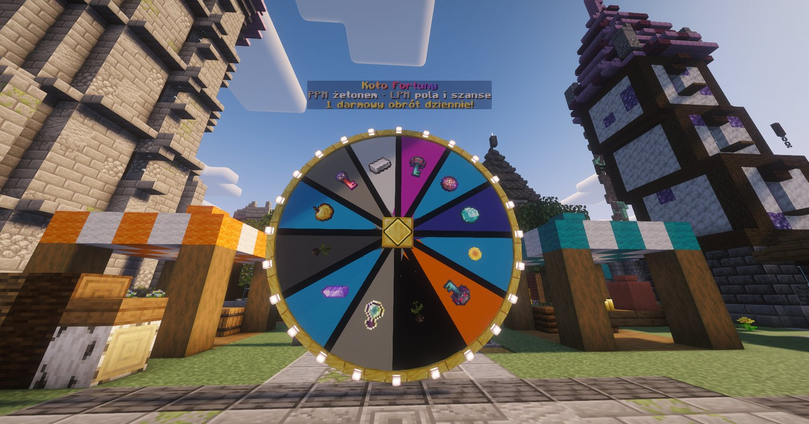
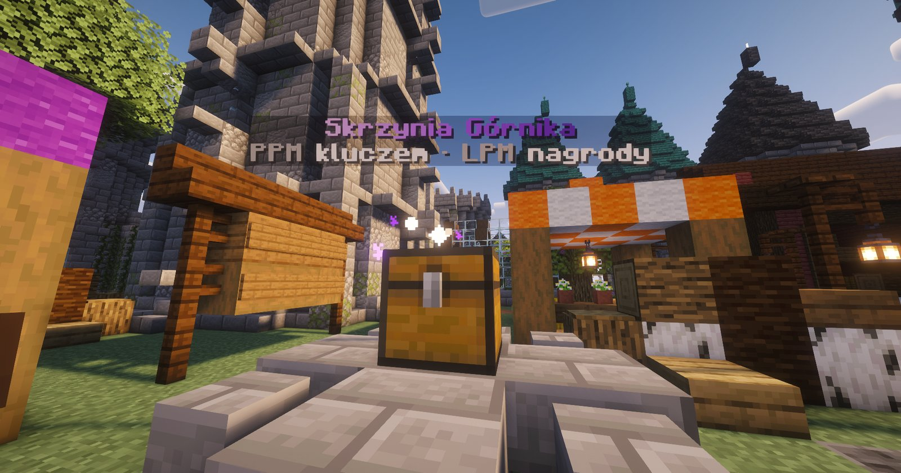

# SunSkrzynki

**English** · [Polski](README.pl.md)

Crates and a wheel of fortune for Paper 26.2. The opening animation happens on the crate itself in the world, not in a GUI roulette, and everything is managed from an in-game admin panel.

<p align="center">
  
  
</p>

## Features

- Physical crates in the world: right-click with a key to open, left-click to preview rewards
- Opening animation with rarity-based reveal and a fanfare for the best drops
- Wheel of fortune built from block displays: up to 16 slices, a free spin once a day, and a "bad luck" slice if you want one
- Admin GUI: create crates, drag rewards in, set weights and rarities, preview drop chances
- Keys are real items, so they can be traded, put in shops or given by other plugins
- Placement wand for crates (floor or wall for the wheel)
- Per-crate logs of who opened what, plus pending rewards for players who log out mid-animation
- Four ready-made crates and a wheel: `/skrzynki przyklady`

## Requirements

- Paper **26.2**
- Java **25**
- [SunCore](https://github.com/oonnyyx/SunCore)

## Installation

1. Download `SunSkrzynki.jar` and `SunCore.jar` from [Releases](../../releases/latest).
2. Drop both into `plugins/` and restart the server.
3. Run `/skrzynki przyklady` to add the example crates, then open `/skrzynki` and place them with the wand.

## Commands

Permission `skrzynki.admin` (op by default). Aliases: `/skrzynka`, `/crates`, `/lootbox`.

| Command | Description |
|---|---|
| `/skrzynki` | Open the admin panel |
| `/skrzynki give <player\|@a> <id> [amount]` | Give keys |
| `/skrzynki lista` | List crates |
| `/skrzynki przyklady` | Add the example crates and wheel |
| `/skrzynki postaw <id> <world> <x> <y> <z>` | Place a crate from the console |
| `/skrzynki test <id>` | Play the animation without a player |
| `/skrzynki reload` | Reload data |

Players without the permission just get a short hint on how to use crates.

## Data

Everything is kept in `plugins/SunSkrzynki/`: `crates.yml` (crates and rewards), `pending.yml`, `spins.yml` and `logs/`.

In-game messages are in Polish.

## Building

```bash
git clone https://github.com/oonnyyx/SunCore && cd SunCore && mvn install && cd ..
git clone https://github.com/oonnyyx/SunSkrzynki && cd SunSkrzynki && mvn package
```

## License

[MIT](LICENSE)
