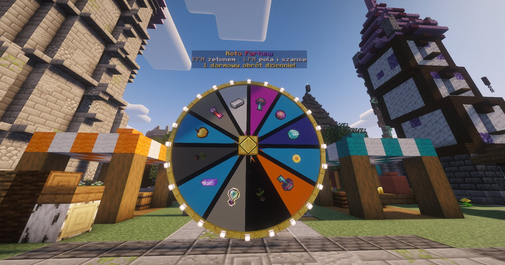
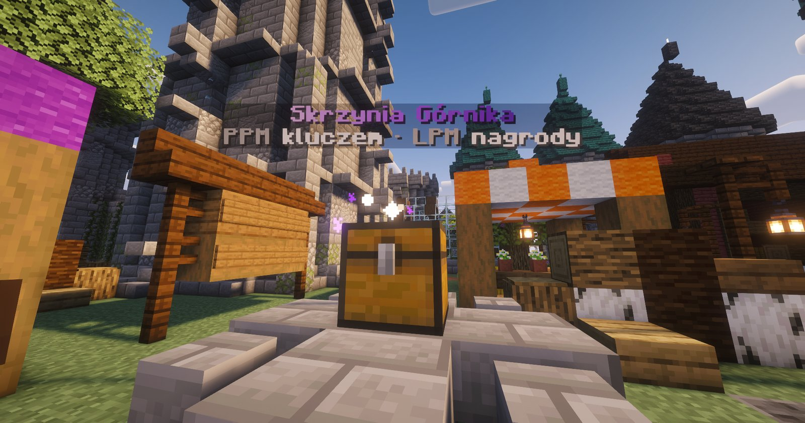

# SunSkrzynki

[English](README.md) · **Polski**

Skrzynki i koło fortuny na Paper 26.2. Animacja otwierania dzieje się przy skrzyni w świecie, a nie w ruletce w GUI. Wszystkim zarządzasz z panelu admina w grze.

<p align="center">
  
  
</p>

## Co potrafi

- Fizyczne skrzynie w świecie: PPM z kluczem otwiera, LPM pokazuje nagrody
- Animacja otwierania z odkryciem zależnym od rzadkości i fanfarą przy najlepszych dropach
- Koło fortuny z block displayów: do 16 pól, darmowy obrót raz dziennie i opcjonalne pole „Pech”
- Panel admina: tworzenie skrzyń, nagrody przeciąganiem, wagi i rzadkości, podgląd szans
- Klucze to zwykłe przedmioty, więc można nimi handlować, sprzedawać w sklepach albo dawać z innych pluginów
- Różdżka do stawiania skrzyń (koło na podłodze albo na ścianie)
- Logi otwarć dla każdej skrzyni i nagrody czekające na graczy, którzy wyszli w trakcie animacji
- Cztery gotowe skrzynie i koło: `/skrzynki przyklady`

## Wymagania

- Paper **26.2**
- Java **25**
- [SunCore](https://github.com/oonnyyx/SunCore)

## Instalacja

1. Pobierz `SunSkrzynki.jar` i `SunCore.jar` z zakładki [Releases](../../releases/latest).
2. Wrzuć oba pliki do `plugins/` i zrestartuj serwer.
3. Wpisz `/skrzynki przyklady`, żeby dodać gotowe skrzynie, a potem otwórz `/skrzynki` i postaw je różdżką.

## Komendy

Uprawnienie `skrzynki.admin` (domyślnie op). Aliasy: `/skrzynka`, `/crates`, `/lootbox`.

| Komenda | Opis |
|---|---|
| `/skrzynki` | Otwiera panel admina |
| `/skrzynki give <gracz\|@a> <id> [ilość]` | Daje klucze |
| `/skrzynki lista` | Lista skrzyń |
| `/skrzynki przyklady` | Dodaje gotowe skrzynie i koło |
| `/skrzynki postaw <id> <świat> <x> <y> <z>` | Stawia skrzynię z konsoli |
| `/skrzynki test <id>` | Odpala animację bez gracza |
| `/skrzynki reload` | Przeładowuje dane |

Gracz bez uprawnienia dostaje tylko krótką podpowiedź, jak otwierać skrzynie.

## Dane

Wszystko leży w `plugins/SunSkrzynki/`: `crates.yml` (skrzynie i nagrody), `pending.yml`, `spins.yml` i `logs/`.

## Budowanie

```bash
git clone https://github.com/oonnyyx/SunCore && cd SunCore && mvn install && cd ..
git clone https://github.com/oonnyyx/SunSkrzynki && cd SunSkrzynki && mvn package
```

## Licencja

[MIT](LICENSE)
